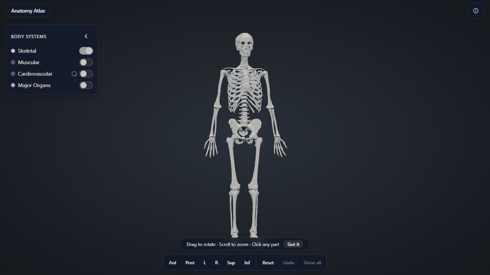

# Anatomy Atlas

Open-source, browser-based 3D human anatomy atlas — explore `1,011` meshes across `582` anatomical structures with instant dissection, plain-English guides, and zero account wall.



Live demo: **[keremvona.github.io/human-body](https://keremvona.github.io/human-body/)**

## Features

- **Eight toggleable body systems across four 3D bundles:** Skeletal (`263` meshes), Muscular (`459` meshes), Cardiovascular (`216` meshes), and five organ systems (`73` meshes across Nervous, Respiratory, Digestive, Urinary, and Lymphatic), each with an independent `0–100%` opacity slider.
- **125 featured structures:** Plain-English overviews, functions, muscle attachments (`origin`, `insertion`, `innervation`, `blood supply`, `action`), bone articulations, key organ/vessel facts, and source links cited directly to OpenStax _Anatomy and Physiology 2e_ (`CC-BY 4.0`) and Wikipedia (`CC-BY-SA 4.0`).
- **Autocomplete search & virtualised tree browser:** Press `/` to search common names, Latin TA terms, and lay synonyms with automatic system loading and camera focus, or switch the left explorer to the `Browse` hierarchy tree with full keyboard navigation and per-row visibility toggles.
- **Real-time dissection tools:** Focus (`F`), Isolate (`I`), Hide (`H`), Fade others (`G`), Left/Right paired switching, context menu (right-click, `Shift+F10`, or long-press), and up to `50` steps of Undo (`Ctrl/Cmd+Z`).
- **Find & Click study quiz:** 10-question timed-feedback quiz over featured structures in enabled systems, pausing dissection tools during active play, saving your best score in `localStorage`, and restoring pre-quiz state when closed.
- **Shareable view links:** Copy a compressed `#v1.` URL capturing camera pose, enabled body systems, opacities, dissection state, selection, and optional pins — loading a link skips deleted IDs with a gentle notice.
- **Personal 3D pins:** Right-click (or long-press on touch) any part and select **Add pin** (`P`) to anchor labeled notes onto the mesh surface with occlusion dimming, mesh-visibility tracking, Undo on delete, and `localStorage` persistence (`atlas.pins.v1`).
- **Configurable graphics quality & visual effects:** Top-bar `Settings` menu (`Auto`, `High`, `Low`) controlling N8AO contact shadows, `#6FA8FF` selection outlines, Fresnel-rimmed x-ray ghosts, and muscle sheen.
- **Camera presets & responsive UI:** Anterior/Posterior/Left/Right/Superior/Inferior presets (`1–6`), zoom (`+`/`-`), reset view (`0`), desktop side Inspector (`>= 768px`), and touch-friendly bottom sheet on mobile viewports.

## Tech Stack

- **UI & State:** React 19, TypeScript, Redux Toolkit, Radix UI (`Dialog`, `Switch`, `Slider`, `Tabs`, `Popover`, `RadioGroup`, `DropdownMenu`), MiniSearch, `@tanstack/react-virtual`, Tailwind CSS v4.
- **3D Engine:** Three.js, React Three Fiber (`frameloop="demand"`), `@react-three/postprocessing` (`N8AO`, `Outline`), `camera-controls`, `three-mesh-bvh`, Meshopt decoding.
- **Asset Pipeline:** Headless Blender 5.3 + `@gltf-transform` / `meshoptimizer` + Zod schema validation.
- **Testing & CI:** Vitest (`node` + `jsdom` projects), Playwright (Desktop Chrome + mobile `Pixel 7` + base-path preview checks), ESLint, Prettier.

## Architecture

Individual meshes are never mounted as React components subscribing to Redux. Instead, `BundleModel` registers every decoded `THREE.Mesh` into `MeshRegistry` (`Map<MeshId, Mesh>`), while `SceneStateApplier` subscribes imperatively to the store, computes only changed states (`selectResolvedMeshStates` → `applyMeshStates`), swaps shared materials from `MaterialLibrary`, and calls `invalidate()` on demand.

Read [docs/architecture.md](docs/architecture.md) for the full layer diagram, slice responsibilities, bundle loading order, and testing strategy, and [docs/pipeline-writeup.md](docs/pipeline-writeup.md) for how a `304.8 MB` `.blend` archive was distilled to `27.71 MB` across four compressed GLB bundles.

## Running Locally

Requires **Node.js 24+**.

```sh
npm install
npm run dev
```

Append `?debug` to the URL to display the live FPS, draw-call, triangle, and mesh count overlay.

Verification commands:

```sh
npm run ci            # typecheck, lint, Vitest suites, check:content, assets:verify, production build
npm run test:e2e      # Playwright Desktop Chrome + Pixel 7 e2e suites against Vite dev server
npm run test:e2e:base # Sub-path production build (ATLAS_BASE_PATH=/atlas-check/) + Vite preview smoke test
```

## Rebuilding 3D Assets

All four compressed bundles (`public/models/*.glb`) and `public/models/manifest.json` are committed in the repository. To regenerate them from upstream source:

1. Install **Blender 5.3** (tested on `5.3.0`) and add its path to `.env.local` (ignored by git):
   ```ini
   BLENDER_PATH=C:\Program Files\Blender Foundation\Blender 5.3\blender.exe
   ```
2. Download `Z-Anatomy.blend` (version `2023-05-02`) to `pipeline/source/Z-Anatomy.blend` (ignored by git).
3. Run the pipeline steps:
   ```sh
   npm run assets:inventory  # survey .blend objects into pipeline/out/inventory.json
   npm run assets:namemap    # reconcile pipeline/name-map.json against selected rules
   npm run assets:build      # headless Blender export + Meshopt optimize + update manifest & index
   npm run assets:verify     # verify budgets, bounds, orientation probes, and mesh/index parity
   ```

See [pipeline/README.md](pipeline/README.md) for licensing exclusions and object selection rules.

## Contributing Content

Educational copy lives in `content/en/index.json` (names, Latin TA names, synonyms, taxonomy metadata) and `content/en/structures/<system>.json` (featured prose, details, and verified sources).

- Follow [content/STYLE.md](content/STYLE.md): write plain English, avoid HTML or Markdown formatting inside JSON text fields, and adapt only from `CC-BY 4.0` (OpenStax) or `CC-BY-SA 4.0` (Wikipedia) with exact `sources[]` citations.
- Validate changes before committing:
  ```sh
  npm run check:content
  npm run content:report
  ```

## Known Gaps

- **Safari, Firefox, and physical phone:** Desktop Chrome, Microsoft Edge, and Playwright `Pixel 7` mobile emulation are verified green; macOS Safari, iOS Safari, Desktop Firefox, and real-device Android Chrome are marked `not tested` in [docs/launch-checklist.md](docs/launch-checklist.md).

## Licensing

- **Code** (`src/`, `pipeline/`, `scripts/`, tests, config): [MIT License](LICENSE).
- **3D Models & Content** (`public/models/`, `content/`): [CC-BY-SA 4.0](LICENSE-ASSETS). Non-commercial (`CC-BY-NC` / `CC-BY-NC-SA`) and unverified-license third-party models present in the upstream `.blend` archive are excluded by pipeline rules.

## Credits

- **3D Models:** [Z-Anatomy](https://github.com/LluisV/Z-Anatomy) (`CC-BY-SA 4.0`), built on BodyParts3D (© The Database Center for Life Science, `CC-BY-SA 2.1 Japan` / `CC-BY 4.0`).
- **Content:** Adapted from [OpenStax _Anatomy and Physiology 2e_](https://openstax.org/books/anatomy-and-physiology-2e/pages/1-introduction) (`CC-BY 4.0`) and [Wikipedia](https://en.wikipedia.org) (`CC-BY-SA 4.0`).

## Disclaimer

This atlas is for learning and curiosity. It is not medical advice.
